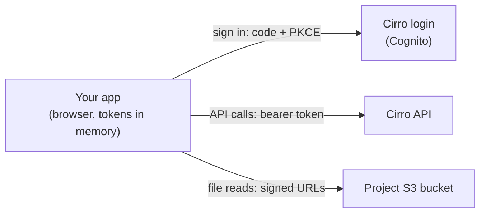

# Architecture

This kit builds **front-end-only apps**: everything runs in the browser, there is no back-end of your own, and you deploy nothing but static files. The user signs in with their own Cirro account, and the app acts as that user — their existing Cirro permissions and project roles are fully respected.

That constraint is the point, not a limitation. It lets a community of developers build, share and modify Cirro apps seamlessly, because shipping one is just hosting static files — no servers to run, no secrets to guard, no user database to manage. The app template in this repo works this way.

## How a front-end app is wired

The app signs the user in with the authorization code flow and PKCE (no client secret — see [authentication](authentication.md)), calls the Cirro API with the resulting bearer token, and reads files with short-lived signed URLs. Every call is made as the signed-in user. The app is registered as a **Public App**; because the code is shipped to the browser, it holds no secret, and its only security concern is keeping the token safe from XSS on your own page.
