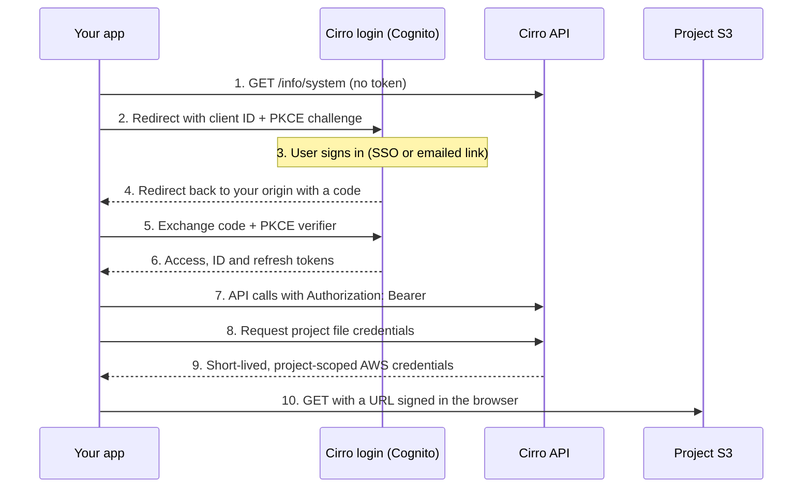

# Authentication

Every Cirro TypeScript package gets tokens from one interface, so adding sign-in means choosing an implementation of it and handing that to the rest of the app.

## The flow

A Public App uses the authorization code flow with PKCE against the tenant's Cognito user pool. Your auth library runs steps 2 to 6; your own code starts at step 7.



Steps 1 to 6 happen once per session. Steps 7 to 10 repeat for each API call and file read; the sdk caches file credentials between reads.

- **Step 1 needs no token.** `/info/system` returns the user pool ID (`auth.userPoolId`), the Cognito hosted domain (`auth.endpoint`), Cirro's own client IDs, the `region`, and the tenant's SSO options (`tenantInfo.loginProviders`).
- **The client ID in step 2 should be yours.** `AmplifyAuthProvider` defaults to Cirro's own UI client; pass your registered app's client ID so sign-ins go through your registration and its permissions.
- **PKCE replaces the client secret.** The library sends only a hash of a random verifier in step 2 and proves possession in step 5, so a stolen code is useless on its own.
- **Renewal is silent.** `getAccessToken()` returns a fresh token when needed; call `forceRefresh()` after changes to the user's groups.

## The interfaces

- **`AuthenticationProvider`** (`@cirrobio/sdk`): `configure(systemInfo)`, `getAccessToken()`, `getCurrentUser()`, `forceRefresh()`. What `DataService` asks for tokens.
- **`InteractiveAuthenticationProvider`** (`@cirrobio/react-core`) adds `loginSSO(providerId)`, `loginEmail`, `finishLoginEmail`, `signOut()`, `getLoginProviders()` and `registerAuthEventHandler()`. Required by `AppConfigProvider` and `react-auth`'s login UI.

## AmplifyAuthProvider

Sign in with `react-auth`'s `AmplifyAuthProvider`, through the app template's `CirroAuthProvider` subclass (`src/auth.ts`). It supports the tenant's SSO providers. Used unmodified, `AmplifyAuthProvider` fails sign-in with `invalid_scope`, as explained below.

Create the provider once, at module scope or with `useMemo`; a new instance per render re-runs configuration. This is what the [app template](../templates/app) does:

```tsx
import { AppConfigProvider } from "@cirrobio/react-core";
import { AuthenticationContextProvider, LoginWrapper } from "@cirrobio/react-auth";
import { CirroAuthProvider } from "./auth";  // the template's src/auth.ts

const auth = new CirroAuthProvider(import.meta.env.VITE_CIRRO_CLIENT_ID);

<AppConfigProvider apiBasePath={import.meta.env.VITE_CIRRO_API} authProvider={auth}>
  <AuthenticationContextProvider>
    <LoginWrapper>
      <App />   {/* useAppConfig().dataService and useAuthenticator() work here */}
    </LoginWrapper>
  </AuthenticationContextProvider>
</AppConfigProvider>
```

`useAuthenticator()` returns `{ authStatus, authInfo, userInfo, refresh }`. `authInfo` holds the signed-in user's `username`. `userInfo` is only populated with `fetchUserInfo`, which calls `getUser` and is refused for most app registrations; see [permissions](permissions.md#checking-before-offering-an-action).

What to know about it:

- It redirects back to `window.location.origin`, so register bare origins, not paths. An app served under a path (a GitHub Pages project site such as `https://<org>.github.io/<repo>/`) must use the full URL as `redirectSignIn`/`redirectSignOut` and register that exact URL; the origin root isn't the app there. Overriding after `super.configure()` isn't enough: Amplify finishes a returning sign-in with the first configuration it sees, so the token request names `window.location.origin`, Cognito answers `invalid_grant`, and `LoginWrapper` (which redirects on its own when the tenant has one login provider) sends the user round again, in a loop (seen on GitHub Pages, 2026-10-15). Configure Amplify yourself instead of calling `super.configure()`, as the app template does, and consider showing a failed return (`signInWithRedirect_failure` on the `auth` Hub channel, or a page load with `?code=`/`?error=` that ends signed out) instead of rendering `LoginWrapper`, so a broken registration can't loop.
- Emailed sign-in links are half-handled, and probably can't work for external apps. `loginEmail` (what `LoginWrapper`'s email option calls) asks Cirro to email a link to `window.location.origin + "/magic-link"`, but nothing in `react-auth` 0.0.8 calls `finishLoginEmail`. The link is `<redirectUri>#<base64url(JSON {username, userCode, iat, exp})>.<signature>`: the whole fragment is the `challenge`, and `username` is in its first segment (Cirro-backend `CustomAuthHandler/magic_link.py`). The backend only accepts a `redirectUri` from its deploy-time `CALLBACK_URLS` setting (`auth_config.py`), which most likely lists the Cirro portal and not registered app origins; that is [not yet confirmed](open-questions.md). Offer SSO only, and filter the `COGNITO` provider out of the login options, unless a sent link has been redeemed end to end on your tenant.
- Emailed sign-in also can't start for a registered app today, before any link is sent. `requestSignInLink` runs Cognito's custom-auth flow (`CUSTOM_WITHOUT_SRP`) with the app's own client ID, and the Cognito app clients created for Public App registrations don't allow it: `InitiateAuth` with `AuthFlow: CUSTOM_AUTH` answers `InvalidParameterException: CUSTOM_AUTH is not enabled for the client.` (dev.cirro.bio and demo.cirro.bio registrations, 2026-10-15). The Cirro portal's own client (`uiAppId` in `/info/system`) does allow it, which is why the portal offers email sign-in. You can check a registration without sending anything by starting the flow for an address with no account:

  ```bash
  curl -s -X POST https://cognito-idp.<region>.amazonaws.com/ \
    -H 'Content-Type: application/x-amz-json-1.1' \
    -H 'X-Amz-Target: AWSCognitoIdentityProviderService.InitiateAuth' \
    -d '{"AuthFlow":"CUSTOM_AUTH","ClientId":"<client id>","AuthParameters":{"USERNAME":"no-such-user@example.invalid"}}'
  ```

  A `CUSTOM_CHALLENGE` answer means custom auth is enabled; the `InvalidParameterException` above means it isn't. For email sign-in to work in an app, all of these have to change: the registration's client must allow `ALLOW_CUSTOM_AUTH` (a Cirro platform change); the magic-link handler's `CALLBACK_URLS` must accept the app's redirect URI; the link must return inside the app (`react-auth` defaults to `origin + "/magic-link"`, outside an app served under a path, so pass the registered redirect URI as `redirectUri`); and the app must redeem the link by calling `finishLoginEmail({ username, challenge })` with the fragment, which `react-auth` 0.0.8 never does.
- It requests the scopes `openid`, `email`, `phone`, `profile` and `aws.cognito.signin.user.admin` (hard-coded in `react-auth` 0.0.8), and Cognito rejects the whole sign-in if the registration disallows any one of them: the app comes back with `?error=invalid_request&error_description=invalid_scope`. Public Apps on dev.cirro.bio allow only `openid` (2026-10-10), and `AppRegistrationInput` has no scopes field. The API accepts tokens issued with `openid` alone (verified 2026-10-11), and `getCurrentUser` needs only claims those tokens carry. The app template therefore uses `CirroAuthProvider` (`src/auth.ts`), which configures Amplify itself with `scopes: ["openid"]` in place of the provider's own `configure()`, and hides the emailed-link option.
- `react-auth` needs MUI 7 and Emotion as peers, and has [known issues](packages.md#known-issues) with workarounds. Mount `AuthenticationContextProvider` only after the tenant config has loaded; see the app template's `ConfigGate`.

## Checking it works

1. Load the app signed out: it should redirect, or show the tenant's login options.
2. After sign-in, call `data.projects.getProjects()` and confirm the list matches what the user sees in Cirro.
3. Once the app is approved, sign in as a second user.
4. Leave the tab past the access-token lifetime and confirm calls still succeed.

If something fails, check [troubleshooting](troubleshooting.md) before changing code; most failures are registration mismatches.
