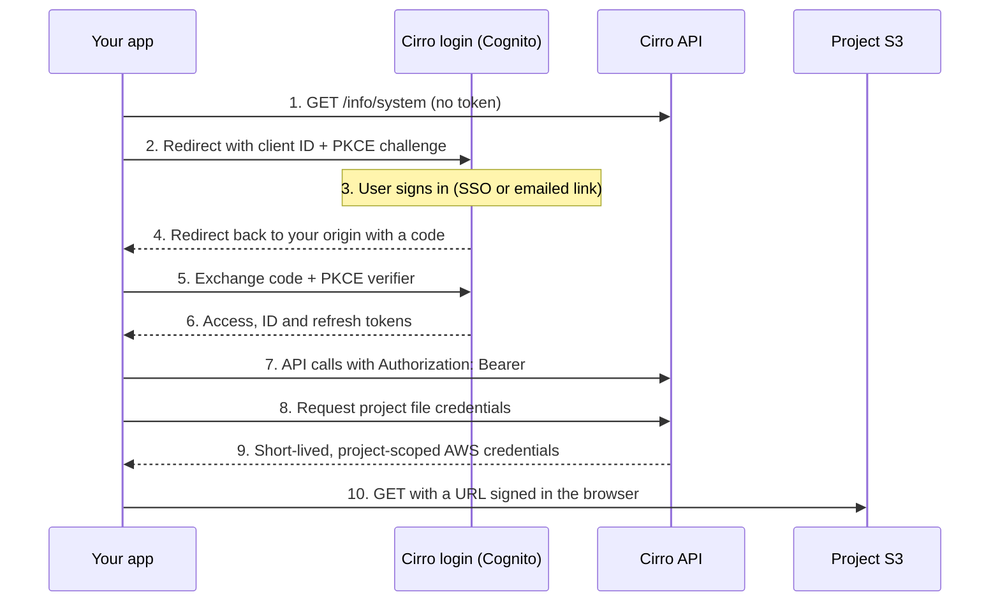

# Authentication

Every Cirro TypeScript package gets tokens from one interface, so adding sign-in means choosing an implementation of it and handing that to the rest of the app.

## The flow

A Public App uses the authorization code flow with PKCE against the tenant's Cognito user pool. Your auth library runs steps 2 to 6; your own code starts at step 7.



Steps 1 to 6 happen once per session. Steps 7 to 10 repeat for each API call and file read; the sdk caches file credentials between reads.

- **Step 1 needs no token.** `/info/system` returns the user pool ID (`auth.userPoolId`), the Cognito hosted domain (`auth.endpoint`), Cirro's own client IDs, the `region`, and the tenant's SSO options (`tenantInfo.loginProviders`).
- **The client ID in step 2 should be yours.** `AmplifyAuthProvider` defaults to Cirro's own UI client; pass your registered app's client ID so sign-ins go through your registration and its permissions.
- **PKCE replaces the client secret.** The library sends only a hash of a random verifier in step 2 and proves possession in step 5, so a stolen code is useless on its own.
- **Renewal is silent.** `getAccessToken()` returns a fresh token when needed; call `forceRefresh()` after changes to the user's groups.

## The interfaces

- **`AuthenticationProvider`** (`@cirrobio/sdk`): `configure(systemInfo)`, `getAccessToken()`, `getCurrentUser()`, `forceRefresh()`. Enough for `DataService` and anything non-React.
- **`InteractiveAuthenticationProvider`** (`@cirrobio/react-core`) adds `loginSSO(providerId)`, `loginEmail`, `finishLoginEmail`, `signOut()`, `getLoginProviders()` and `registerAuthEventHandler()`. Required by `AppConfigProvider`, `react-auth`'s login UI, and `ViewerProvider`.

## Choosing a provider

| Situation | Use |
| --- | --- |
| Viewer or tool built on `@cirrobio/react-tool` | `new AmplifyAuthProvider(clientId)` passed to `ViewerProvider` |
| React app using Cirro's login UI | `AppConfigProvider` + `AuthenticationContextProvider` + `LoginWrapper` with `AmplifyAuthProvider(clientId)` |
| Non-Amplify stack, or you prefer a standard OIDC library | [Custom provider over oidc-client-ts](#public-app-over-oidc-client-ts) |
| Local development without a login loop | [Static token](#static-token-development-only); never ship it |

Prefer `AmplifyAuthProvider` with the React packages: it supports the tenant's SSO providers and Cirro's emailed sign-in links, which a generic OIDC library won't.

## AmplifyAuthProvider

Create the provider once, at module scope or with `useMemo`; a new instance per render re-runs configuration.

In a React app without `ViewerProvider` (this is what the [app template](../templates/app) does):

```tsx
import { AppConfigProvider } from "@cirrobio/react-core";
import { AmplifyAuthProvider, AuthenticationContextProvider, LoginWrapper } from "@cirrobio/react-auth";

const auth = new AmplifyAuthProvider(import.meta.env.VITE_CIRRO_CLIENT_ID);

<AppConfigProvider apiBasePath={import.meta.env.VITE_CIRRO_API} authProvider={auth}>
  <AuthenticationContextProvider fetchUserInfo>
    <LoginWrapper>
      <App />   {/* useAppConfig().dataService and useAuthenticator() work here */}
    </LoginWrapper>
  </AuthenticationContextProvider>
</AppConfigProvider>
```

`useAuthenticator()` returns `{ authStatus, authInfo, userInfo, refresh }`; `userInfo` is only populated with `fetchUserInfo`. For viewers, see [viewers](viewers.md).

What to know about it:

- It redirects back to `window.location.origin`, so register bare origins, not paths.
- It requests the scopes `openid`, `email`, `phone`, `profile` and `aws.cognito.signin.user.admin`. Whether a Public App allows all of these is [not yet confirmed](open-questions.md).
- `react-auth` needs MUI 7 and Emotion as peers, and has two [known issues](packages.md#known-issues) with workarounds.

## Checking it works

1. Load the app signed out: it should redirect, or show the tenant's login options.
2. After sign-in, call `data.projects.getProjects()` and confirm the list matches what the user sees in Cirro.
3. Once the app is approved, sign in as a second user.
4. Leave the tab past the access-token lifetime and confirm calls still succeed.

If something fails, check [troubleshooting](troubleshooting.md) before changing code; most failures are registration mismatches.

## Public App over oidc-client-ts

Standard OIDC code flow with PKCE against the tenant's Cognito user pool. Supports the tenant's SSO providers through Cognito's `identity_provider` parameter. It does not support Cirro's emailed sign-in link, which is a custom Cognito flow; if users rely on it, use `AmplifyAuthProvider` instead.

```typescript
import { UserManager, WebStorageStateStore, InMemoryWebStorage } from "oidc-client-ts";
import { CurrentUser } from "@cirrobio/sdk";
import type { SystemInfoResponse, LoginProvider } from "@cirrobio/api-client";
import type { InteractiveAuthenticationProvider, AuthEventHandlerOptions } from "@cirrobio/react-core";

export class OidcCirroAuthProvider implements InteractiveAuthenticationProvider {
  private manager!: UserManager;
  private loginProviders: LoginProvider[] = [];
  private ready!: Promise<void>;

  constructor(private readonly clientId: string, private readonly redirectPath = "/") {}

  configure(config: SystemInfoResponse): void {
    this.loginProviders = config.tenantInfo.loginProviders;
    this.manager = new UserManager({
      authority: `https://cognito-idp.${config.region}.amazonaws.com/${config.auth.userPoolId}`,
      client_id: this.clientId,
      redirect_uri: window.location.origin + this.redirectPath,
      post_logout_redirect_uri: window.location.origin,
      response_type: "code",                     // PKCE is automatic for code flow
      scope: "openid email profile",             // must be allowed on the registration
      automaticSilentRenew: true,                // uses the refresh token
      userStore: new WebStorageStateStore({ store: new InMemoryWebStorage() }), // tokens in memory only
    });
    // Finish a redirect if we just came back from the login page
    const params = new URLSearchParams(window.location.search);
    this.ready = params.has("code") && params.has("state")
      ? this.manager.signinRedirectCallback().then(() => {
          window.history.replaceState({}, "", window.location.pathname);
        })
      : Promise.resolve();
  }

  async getAccessToken(): Promise<string> {
    await this.ready;
    let user = await this.manager.getUser();
    if (!user || user.expired) user = await this.manager.signinSilent().catch(() => null);
    if (!user) throw new Error("Not signed in");
    return user.access_token;
  }

  async getCurrentUser(): Promise<CurrentUser> {
    await this.ready;
    const user = await this.manager.getUser();
    if (!user) throw new Error("Not signed in");
    return CurrentUser.fromCognitoUser(user.profile as Record<string, any>);
  }

  async forceRefresh(): Promise<void> { await this.manager.signinSilent(); }

  async loginSSO(providerId: string): Promise<void> {
    await this.manager.signinRedirect({ extraQueryParams: { identity_provider: providerId } });
  }
  async loginEmail(): Promise<void> { throw new Error("Emailed sign-in links need AmplifyAuthProvider"); }
  async finishLoginEmail(): Promise<void> { throw new Error("Emailed sign-in links need AmplifyAuthProvider"); }
  async signOut(): Promise<void> { await this.manager.removeUser(); await this.manager.signoutRedirect(); }
  getLoginProviders(): LoginProvider[] { return this.loginProviders; }

  registerAuthEventHandler(options?: AuthEventHandlerOptions): void {
    if (options?.onSignIn) this.manager.events.addUserLoaded(options.onSignIn);
    if (options?.onSignOut) this.manager.events.addUserSignedOut(options.onSignOut);
  }
}
```

Notes:
- With in-memory storage, a page reload loses the session and triggers a silent sign-in or a redirect. That's the safer trade; switch to `sessionStorage` only if you accept the XSS exposure.
- Cognito's sign-out endpoint expects `logout_uri` and `client_id`; if `signoutRedirect()` errors, redirect to `https://<auth.endpoint>/logout?client_id=...&logout_uri=...` manually.
- If `react-auth`'s `LoginOptions` is used, it will show an email option that this provider can't serve. Use your own login button that calls `loginSSO` instead.

## Static token (development only)

```typescript
import { StaticInteractiveAuthTokenProvider } from "@cirrobio/react-auth";
const auth = new StaticInteractiveAuthTokenProvider(import.meta.env.VITE_DEV_CIRRO_TOKEN);
```

Guard it so it cannot reach production, for example `import.meta.env.DEV ? static : amplify`, and keep the token out of committed `.env` files.
