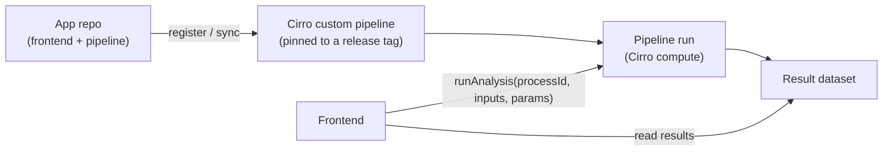
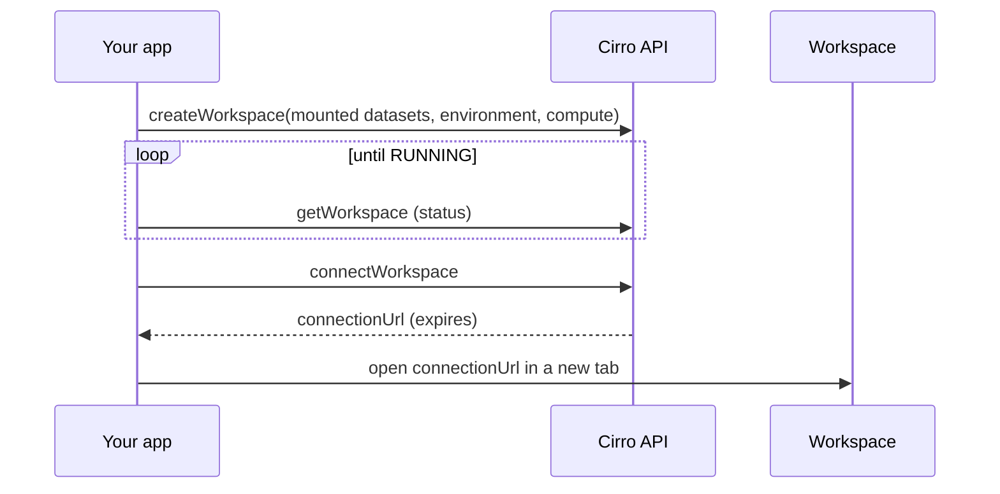

# Building on Cirro: what an app can do

Most of this kit explains how to call the Cirro API. This page explains why you would, and what becomes possible when you do. An app built on Cirro gets more than a data backend: it gets a research environment, with storage, compute, interactive servers, sharing and record-keeping. Knowing what that environment offers changes what's worth building.

## Why build on Cirro

A research web app usually ends up rebuilding the same infrastructure: somewhere to store large files, a way to run heavy analysis, a way to hand data to collaborators, user accounts, and an audit trail. On Cirro, the app can skip all of that and use what the research environment already provides:

- **Data stays where researchers already work.** Everything the app reads or creates lives in Cirro projects the user owns, under their institution's governance. If the app goes away, the data, results and records stay.
- **Heavy computation is someone else's problem.** The app submits work to Cirro's pipeline execution and gets results back as datasets. It doesn't run servers, queues or clusters.
- **Access control is inherited.** A signed-in user's token only reaches what that user can already see, narrowed further by the permissions on the app's registration. The app doesn't manage accounts.
- **The app can stay thin.** With state and storage in Cirro, many apps can be static frontends: easy to host, easy to hand over, and nothing holding data to secure.

## The mental model: a guest in the user's research environment

An app acts on the user's behalf, inside projects the user controls. It is bounded by three things:

1. **What the user can do** in Cirro (their project roles).
2. **What the app is registered to do** (its permissions, reviewed when an admin approves it). See [app types and registration](app-types-and-registration.md).
3. **What the app chooses to do**, which is where judgment comes in. See [trust boundaries](#trust-boundaries) below.

The first two are covered in detail in [permissions](permissions.md): how an app declares what it needs, and how it should behave when a user can't do everything the app offers.

Each tenant decides separately whether to connect an app, and with which permissions; see [connecting to tenants](connecting-to-tenants.md).

Anything the app creates outlives the session and belongs to the project, not the app. Design for that: the next person to look at a dataset your app made may never have used your app.

## Capability map

Each row is something an app can use. Permission names are the likely ones for each capability; confirm them against your registration while testing.

| Capability | What it lets an app do | API | Likely permissions |
| --- | --- | --- | --- |
| **Dataset storage** | Read datasets and files; upload new datasets; update names, descriptions and tags | `DatasetsApi`, `FileApi`; see [files](files.md) | `VIEW_DATASET`, `CREATE_DATASET`, `EDIT_DATASET`, `GENERATE_DOWNLOAD_TOKEN` |
| **Pipeline execution** | Run a pipeline on datasets, track tasks and logs, see what runs cost, stop runs; outputs become new datasets. `ExecutionApi.calculateCost` reports what a run cost; it can take ~20 s on older runs, so load it in the background. For a run's duration use its tasks' `requestedAt` and `stoppedAt`: a dataset's `updatedAt` moves whenever it is edited | `ExecutionApi` (`runAnalysis`, `getTasksForExecution`, `getExecutionLogs`, `calculateCost`, `stopAnalysis`) | `RUN_ANALYSIS`, `STOP_ANALYSIS`, `VIEW_DATASET_LOGS` |
| **Pipelines as app code** | Register a Nextflow or Cromwell pipeline from a GitHub repo, including the app's own repo, and keep it in sync | `ProcessesApi` (`createCustomProcess`, `syncCustomProcess`, `getProcessParameters`) | `CREATE_CUSTOM_PIPELINE`, `MANAGE_CUSTOM_PIPELINES` |
| **Interactive workspaces** | Create a workspace with datasets mounted (it starts by itself), restart a stopped one, and get a connection URL to hand the user into it | `WorkspacesApi` (`createWorkspace`, `startWorkspace`, `connectWorkspace`, `stopWorkspace`) | `CREATE_WORKSPACE`, `CONTROL_WORKSPACE`, `OPEN_WORKSPACE` |
| **Sharing between projects** | Publish datasets from one project and subscribe to them in another, without copying | `SharingApi` | `VIEW_PROJECT_SHARES`, `MANAGE_PROJECT_SHARES` |
| **Sample metadata** | Read and update sample metadata and the project's metadata schema | `MetadataApi` | `VIEW_PROJECT_METADATA`, `EDIT_PROJECT_METADATA` |
| **Sheets (relational tables)** | A database in the project: typed tables with keys and relationships, joined views, read-only SQL, file ingest. See [Sheets](sheets.md) | `SheetsApi` | `VIEW_SHEET_DATA`, `CREATE_SHEET`, `EDIT_SHEET_DATA`, `SHEET_RAW_QUERY` |
| **Notes and discussions** | Attach notes or discussion threads to datasets, samples, workspaces and other entities | `FeedApi` (discussions of type `NOTES` or `DISCUSSION`) | `CREATE_DISCUSSION`, `VIEW_DISCUSSION` |
| **Reference data** | Use and add project reference genomes and annotations | `ReferencesApi` | `VIEW_PROJECT_REFERENCES`, `EDIT_PROJECT_REFERENCES` |
| **Dashboards** | Create project dashboards from templates | `DashboardsApi` | `VIEW_DASHBOARD`, `CREATE_DASHBOARD` |
| **Project membership** | Read project members; set user roles | `ProjectsApi` (`getProjectUsers`, `setUserProjectRole`) | `VIEW_PROJECT_MEMBERS`, `EDIT_PROJECT_MEMBERS`; see [trust boundaries](#trust-boundaries) |

Method details are in the [API reference](../reference/api-surface.md). List the permissions your app uses in its [permission manifest](permissions.md#layer-1-declare-what-the-app-needs).

## Architectural patterns

### An app that ships its own pipeline

An app can contain both a frontend and the HPC pipeline it depends on, in one repository. Cirro registers custom pipelines from a GitHub repo (`pipelineCode`: repository path, version, entry point; Nextflow or Cromwell), so the pipeline can live next to the UI that drives it.

```
my-app/
├── frontend/          the web app (from templates/app)
├── pipeline/          Nextflow workflow + Cirro process config
└── README.md
```



What this buys you:

- **One version for the whole app.** Pin the registered pipeline to the same release tag as the frontend, so the UI always calls a pipeline whose parameters it understands.
- **The UI can be driven by the pipeline.** `getProcessParameters` returns the pipeline's parameter schema, so forms can be generated from it rather than duplicated.

Registering the pipeline is a one-time admin step, done by the app's maintainers, not by the app at runtime for each user. Treat `createCustomProcess` as deployment tooling.

### Launching a workspace and handing the user off

Some work is better done interactively: exploring results in a notebook, RStudio or a desktop tool. An app can set up that environment and pass the user into it:



Things to get right:

- **Mount exactly what's needed.** `mountedDatasets` decides what the user sees; mount the datasets the app is working with, not the whole project.
- **Pick the environment deliberately.** `getWorkspaceEnvironments` lists what's available, with default compute; let the user confirm size if it affects cost.

Booting takes minutes, a project can limit how many workspaces each user has, workspaces open in a new tab (they can't be embedded in another site), and they cost money until they stop. [Workspaces](workspaces.md) covers all of it.

### Provenance by default: notes on everything the app creates

Anything an app creates should explain itself to someone who never used the app. We recommend a simple convention: **whenever an app creates a dataset, workspace, pipeline run or other asset, it attaches a note** describing what it did.

Notes are discussions of type `NOTES` attached to an entity (`DATASET`, `SAMPLE`, `WORKSPACE`, `PROJECT`, and others):

Notes go through `data.feed`:

```typescript
import { EntityType, DiscussionType } from "@cirrobio/api-client";

export async function addProvenanceNote(projectId: string, entity: { type: EntityType; id: string }, body: string) {
  const note = await data.feed.createDiscussion({ discussionInput: {
    name: `Created by ${APP_NAME}`,
    description: `${APP_NAME} ${APP_VERSION}`,
    entity, type: DiscussionType.Notes, projectId,
  }});
  await data.feed.postMessage({ discussionId: note.id, messageInput: { message: body } });
}
```

A useful note says, in plain language:

- which app and version created the asset, and a link back to it;
- who ran it and when;
- the inputs (dataset names and IDs) and the parameters used;
- why, if the user gave a reason or label.

Pair notes with the app's tag (below), so assets can be found by app as well as read about. The cost is a few lines of code; the benefit is a project whose history makes sense years later.

### Tag everything the app creates

Every taggable entity an app creates carries one tag naming the app: `{ key: "cirro-app", value: APP_ID }`. `APP_ID` is a stable slug chosen once for the app (`spatial-data-studio`), not its registration or client ID, which differ in every tenant. With it, a user or another app can find everything an app made with one filter, in any tenant.

Set the tag when the entity is created, where the API allows it, rather than in a second call:

| Entity | Where the tag goes |
| --- | --- |
| Uploaded dataset | `uploadDataset({ uploadDatasetRequest: { …, tags } })` |
| Pipeline run (its output dataset) | `runAnalysis({ runAnalysisRequest: { …, tags } })` |
| Existing dataset the app modifies | `updateDataset` with the existing tags plus the app's, never replacing the user's |
| Sheet | `TableSheetInput.tags` / `ViewSheetInput.tags`; also give the app its own sheet namespace |
| Custom pipeline | `CustomProcessInput.tags` |
| Dashboard | `DashboardInput.tags` |

Entities without tags (workspaces, discussions) are identified by a name prefix and the provenance note instead, e.g. `my-app / RNA velocity`. Workspace names must start with a letter or digit and may contain only letters, digits, spaces and `.&-@!#'()/` (Cirro rejects anything else with a 400), so `/` makes a good separator and `:` does not. Check the installed `@cirrobio/api-client` for a `tags` field before assuming an entity has none.

### Other patterns

- **Keep state in Cirro, not in the app.** Pipeline runs, workspaces and datasets are durable and visible in the Cirro UI. An app that reads status from Cirro can be closed and reopened, or replaced, without losing track of work.
- **Move data with shares, not copies.** When an app brings data from one project into another, a share keeps a single copy and leaves a record of who has access.
- **Use sheets as the app's database.** Records the app creates or curates, and tabular results people will query, belong in [sheets](sheets.md): a browser-only app gets relational storage with no backend, and the data stays in the user's project.

## Trust boundaries

Being able to call an API doesn't mean an app should. Sort actions by how much they ask the user to trust the app:

| Category | Examples | Recommendation |
| --- | --- | --- |
| Read | List datasets, read files, view metadata | Fine with minimal permissions |
| Create | Upload datasets, add notes, create sheets | Fine; always leave a provenance note |
| Spend | Run pipelines, start workspaces | Get explicit confirmation each time |
| Change | Edit metadata, update dataset details, stop runs | Confirm, and say what will change |
| Destroy | Delete datasets or workspaces | Confirm with the asset named; consider leaving deletion to the Cirro UI |
| Govern | Set user roles, create or revoke shares | Generally leave to the Cirro UI. If an app must, register those permissions only for that app, scope them to specific projects, and confirm every change |

Registered permissions are the hard limit, and admin approval is where they get reviewed. Keep apps that only read or create data separate from apps that change access, so approving one doesn't mean trusting the other with everything.

## Questions to ask when designing an app

- What does the app read, what does it create, and in which projects?
- Does it need compute? Should the pipeline live in the app's repository?
- Is there a point where the user should move into an interactive workspace?
- What will someone see in Cirro a year from now, looking at what the app created? Is it explained by notes and tags?
- Which actions spend money or change access, and how does the app confirm them?
- What's the smallest set of permissions that supports all of the above, and which features still work for a user who can only read?
