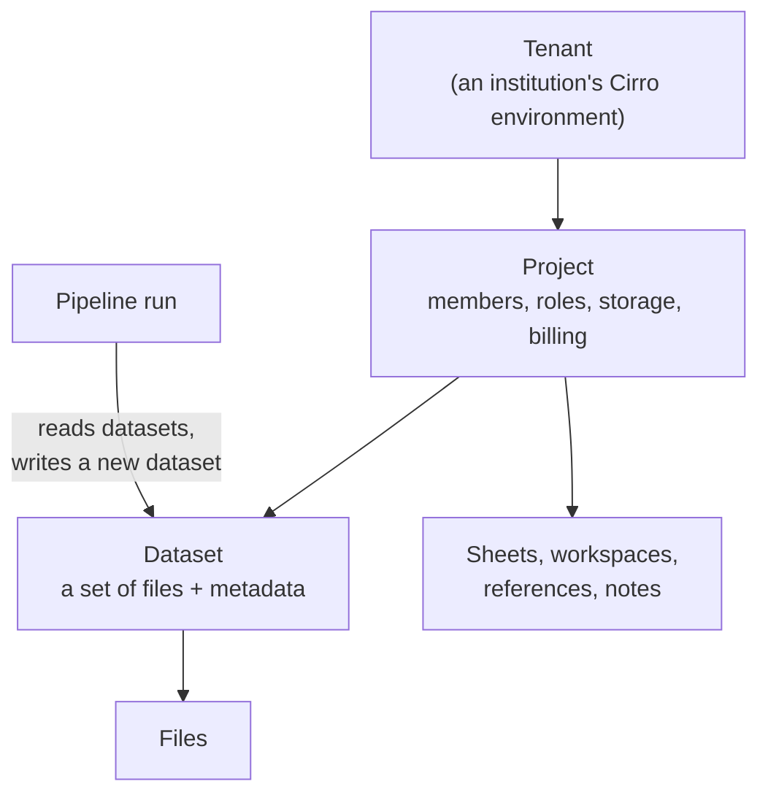

# Cirro in five minutes

Cirro is a cloud platform where research groups keep their scientific data, run analysis pipelines on it, and share results. Institutions run their own Cirro environments, and researchers work inside projects in them. An app built on Cirro signs a researcher in and works with their projects on their behalf.

This page is the vocabulary the rest of the kit assumes.

## How the pieces fit

## Glossary

| Term | What it means |
| --- | --- |
| **Tenant** | An independent Cirro environment, usually run for one institution, with its own users, projects, sign-in and web address. There is also a public Cirro tenant. Apps are connected to tenants one at a time; see [connecting to tenants](connecting-to-tenants.md). |
| **Project** | The unit of work and access. A project has members, storage for its data, a billing account for the compute it uses, and everything below lives in one. Most API calls take a `projectId`. |
| **Role** | A member's level of access in a project: `OWNER`, `ADMIN`, `CONTRIBUTOR` or `COLLABORATOR`. The same person can have different roles in different projects. See [permissions](permissions.md). |
| **Dataset** | A collection of files with a name, description, tags and status. Datasets are created by uploading files or by running a pipeline. `processId` records what kind of data it is or which pipeline made it, and `sourceDatasetIds` links pipeline outputs to their inputs. |
| **Files and manifest** | A dataset's files are listed in its manifest. Apps don't get permanent links to files: they get short-lived credentials or signed URLs at the moment of use. See [working with files](files.md). |
| **Pipeline (process)** | An analysis workflow, typically Nextflow or Cromwell, that runs on Cirro's compute. The API calls pipelines **processes**; the same term also covers the data types used when uploading. |
| **Analysis (execution)** | One run of a pipeline on one or more datasets. It produces a new dataset, and the API reports its tasks, logs and cost. |
| **Samples and metadata** | Per-sample information (for example tissue, condition, batch) attached to datasets, following a schema defined for the project. |
| **Sheet** | A relational table in a project, with a typed schema and SQL queries. Apps can use sheets as a database; see [Sheets](sheets.md). |
| **Workspace** | An interactive compute environment (such as a notebook server) with datasets mounted, which a user opens in the browser. |
| **Share** | A way to make datasets from one project available in another without copying them. |
| **Reference** | Reference data used by pipelines, such as genomes and annotations, stored in a project. |
| **Notes and discussions** | Comment threads attached to datasets, samples, workspaces and other objects. Apps should use notes to record what they did; see [provenance by default](building-on-cirro.md#provenance-by-default-notes-on-everything-the-app-creates). |
| **Tags** | Key/value labels on datasets, sheets and other objects, used for finding and organizing things. |
| **App registration** | A record of an app — its client ID, where it runs, and the permissions it may use — created in a tenant by a tenant admin, or by a user with the App Developer role, whose registrations only they can sign in to until a tenant admin approves them. The Cirro team registers apps on the public tenant. See [app types and registration](app-types-and-registration.md). |

## How an app works with Cirro

1. The user opens the app and is sent to Cirro's authorize page, which shows what the app is asking for; they sign in there with their Cirro account for one tenant.
2. The app gets a token that acts as that user, limited to the permissions the tenant granted the app.
3. The app calls the tenant's API with that token: listing projects, reading datasets, running pipelines, writing sheets.
4. To read or write files, it asks the API for short-lived credentials and talks to storage directly.

Everything the app creates lands in the user's project, where other members see it in the Cirro web interface.

Next: [getting started](getting-started.md) gets a template running against a real tenant.
