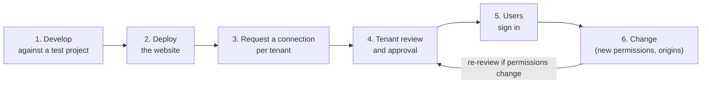

# Connecting your app to Cirro tenants

Deploying your app as a website makes it reachable, but not useful yet. Users can only sign in and work with their data once the app is **connected to a Cirro tenant**: registered in that tenant and approved by the people who run it. This page explains how that works, who does what, and how to request a connection.

## Tenants

A Cirro **tenant** is an independent research environment, usually run by or for one institution, with its own users, projects, data, governance and admins. Each tenant has its own web address, API and sign-in.

There is also a **public Cirro tenant**, run by Cirro, open to researchers who aren't part of an institutional tenant. It's the natural first place to connect an app, and the place to start if you're developing an app without an institutional home.

An app is connected tenant by tenant. Connecting to one tenant gives no access to any other; each tenant reviews and approves the app on its own terms.

## Who's involved

| Role | Responsibilities |
| --- | --- |
| **App developer** (publisher) | Builds and hosts the app; maintains its [permission manifest](permissions.md#layer-1-declare-what-the-app-needs); requests connections; keeps registrations up to date |
| **Tenant admins** | Review connection requests for their tenant; register and approve apps; decide which permissions and projects an app gets |
| **Cirro support** | Handles connection requests for the public tenant, and helps route requests to institutional tenants |
| **Users** | Sign in to a connected app with their tenant account; the app acts within their own access |

## The lifecycle of a connected app



1. **Develop.** Build against a test project, using a development registration that only you can sign in to until it's approved (see [getting started](getting-started.md)). Keep the [permission manifest](permissions.md) current as you go.
2. **Deploy.** Host the app at its production URL (see [deployment](deployment.md)). The URL is part of the registration, so settle it before requesting connections.
3. **Request a connection** for each tenant whose users should use the app (see below).
4. **Tenant review and approval.** The tenant registers the app (or approves your registration) with the permissions it accepts, scoped to the projects it chooses. Until approval, only the app's creator can sign in.
5. **Users sign in.** Users of that tenant can now use the app. If the tenant enables discovery, they can also find it in Cirro.
6. **Change.** Adding origins or permissions means updating the registration in every connected tenant. Permission changes usually mean another review, so batch them and say what changed and why.

When an app is retired, ask each tenant to archive its registration, so no one can sign in to an app that's no longer maintained.

## Requesting a connection

### The public Cirro tenant

Email **support@cirro.bio** with the details listed below. Cirro support reviews the request, sets up the registration, and sends you the client ID and the tenant's API URL.

### Institutional tenants

Contact that tenant's Cirro admins. If you don't know who they are, the tenant's contact email is in its system info (`tenantInfo.contactEmail` from `/info/system`), or email support@cirro.bio and ask to be put in touch.

### What to include

A complete request is quicker to approve. Include:

- **App:** name, one-paragraph description, who publishes and maintains it, and a contact email. If you developed against a registration in this tenant, include its client ID so it can be updated and approved rather than recreated.
- **Where it runs:** the production URL and any other origins that need to sign in (these become redirect URIs). Note whether it also runs embedded in Cirro.
- **App type:** Public App (browser-only; the only type this kit covers). See [app types](app-types-and-registration.md).
- **Permissions:** your `cirro-permissions.json`, with required and optional permissions and their reasons. Say whether grants can be scoped to specific projects.
- **Data handling:** whether the app sends any Cirro data, or data derived from it, anywhere other than the user's browser and Cirro (your own backend, analytics, third-party APIs). If not, say so.
- **What it creates:** whether it runs pipelines, starts workspaces, or creates datasets, and that it leaves [provenance notes](building-on-cirro.md#provenance-by-default-notes-on-everything-the-app-creates) on what it creates.
- **Review evidence:** the result of `tools/scan.py` and confirmation that you've worked through the [security checklist](security-checklist.md).
- **Intended users:** who in that tenant asked for the app or will use it. Requests backed by a lab or group in the tenant move faster.

## Serving more than one tenant

Each tenant has its own API URL and issues your app its own client ID. Users of one deployed app may belong to different tenants, and tenants come and go as admins approve or withdraw the app. You can handle that in two ways:

| Approach | How | Good for |
| --- | --- | --- |
| **Runtime tenant registry** (recommended) | Serve a `tenants.json` next to the app listing each tenant's API URL and client ID; the app fetches it at startup and shows a tenant picker | Any number of tenants; adding or removing one is a file edit, with no rebuild |
| **One build per tenant** | Build with that tenant's `VITE_CIRRO_API` and `VITE_CIRRO_CLIENT_ID`, and deploy each to its own URL (for example `tenant-a.myapp.org`) | One tenant, or tenants that want the app on their own domain |

### The tenant registry

`tenants.json` is fetched at runtime, not imported, so the deployer adds or removes a tenant by editing one file on the host:

```json
{
  "tenants": [
    {
      "id": "dev",
      "name": "Cirro (dev)",
      "api": "https://dev.cirro.bio/api",
      "clientId": "1a2b3c4d5e6f7g8h9i0j",
      "addedAt": "2026-10-10",
      "contact": "admins@example.org"
    }
  ]
}
```

- `id`: a short slug, stable for the life of the entry; the app remembers the user's choice by it.
- `api`: the tenant's API base URL (`/api` in development, through the dev proxy).
- `clientId`: the client ID the tenant's admins issued **for this app**. Client IDs of Public Apps are not secrets, so the file can be public and committed.
- `name`, `addedAt`, `contact`: shown in the picker, or kept for whoever maintains the file.

Adding a tenant: the tenant's admins register the app with your production origin as a redirect URI and send you the client ID; you add an entry. Removing one: delete the entry. Users who chose it see the picker on their next visit.

Each app has its own registry, because each app has its own registration in each tenant: a tenant may approve one app and not another. Apps that share a host still keep separate files.

### Choosing the tenant at startup

Pick the tenant before anything calls Cirro, and create the auth provider for it:

```typescript
type Tenant = { id: string; name: string; api: string; clientId: string };
const TENANT_KEY = "cirro-tenant";   // the tenant's id is not sensitive

export async function loadTenants(): Promise<Tenant[]> {
  const res = await fetch(`${import.meta.env.BASE_URL}tenants.json`, { cache: "no-cache" });
  if (!res.ok) throw new Error(`Could not load tenants.json (HTTP ${res.status})`);
  const { tenants } = await res.json();
  if (!Array.isArray(tenants) || !tenants.length) throw new Error("tenants.json lists no tenants");
  return tenants;
}

export const savedTenant = (tenants: Tenant[]) =>
  tenants.find((t) => t.id === localStorage.getItem(TENANT_KEY));

export function chooseTenant(t: Tenant) {
  localStorage.setItem(TENANT_KEY, t.id);
  window.location.reload();          // providers are created once, for one tenant
}

// main.tsx: render a picker until savedTenant() returns one, then
// const auth = new AmplifyAuthProvider(tenant.clientId);
// <AppConfigProvider apiBasePath={tenant.api} authProvider={auth}>…
```

- With a single entry, skip the picker.
- After the tenant's config loads, show its name and logo (`tenantInfo.name` and `tenantInfo.tenantLogoUrl`) so users can see which environment they're signed in to.
- Never mix data between tenants in one session: switching tenant means signing out, clearing the saved choice, and starting again.
- If the saved tenant is no longer in the file, clear the choice and show the picker.

Register every origin the app is served from in every tenant that uses it.

## Embedded viewers

Viewers that run inside the Cirro UI are connected differently from standalone apps: they're added to a tenant as tools, rather than signing users in through a registration. Ask support@cirro.bio how to make an embedded viewer available in a tenant. If the same viewer also runs standalone, it needs a regular connection request for that use.

## Planning ahead

- **Ask early.** Connection and approval involve people. Request the public-tenant connection when the app is usable, not the day before a demo.
- **Keep one manifest for all tenants.** Tenants may grant less than you ask for; that's what [optional permissions](permissions.md#degrading-gracefully) are for.
- **Track your connections.** Keep a list of connected tenants, their client IDs, contacts and approved permissions in the app's repo (not secrets: client IDs for public apps aren't confidential). You'll need it every time the registration changes.
