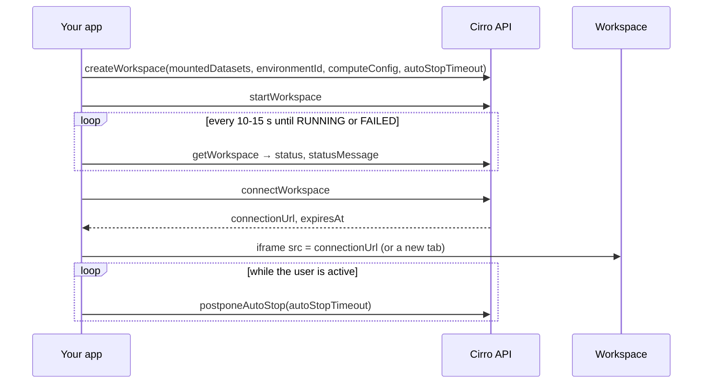

# Workspaces

A workspace is a container the user runs in their own project: JupyterLab, RStudio, VS Code, or any web app packaged as an image, with datasets mounted. For a front-end-only app it's the way to get interactive server-side compute (a Python kernel holding a large AnnData object, a Shiny app, a desktop tool) without running a back-end of your own. The workspace runs as the user, in their project, billed to it.

Use one when the work is interactive and too heavy for the browser. Use a [pipeline run](building-on-cirro.md#an-app-that-ships-its-own-pipeline) when it is batch work with a defined output, and the browser when the data fits in memory there.

## Lifecycle



`Workspace.status` moves through `PENDING`/`STARTING` to `RUNNING`, and through `STOPPING` to `SUSPENDED` (stopped, can be started again). `FAILED` carries a `statusMessage`; `getWorkspaceLogs` has the detail.

## Booting takes minutes; say so

Starting a workspace usually takes a few minutes: the instance has to be provisioned and the image pulled. Users who aren't told assume the app is broken.

- Before starting, say how long it will take ("Starting a workspace takes a few minutes") and what it will cost if the compute choice affects that.
- While it boots, show the elapsed time and the current `statusMessage`, and let the user keep working elsewhere in the app. Don't block the whole UI.
- Reuse before creating. List the project's workspaces (`getWorkspaces`), and offer to start a `SUSPENDED` one the app created earlier for the same purpose instead of making a new one. Find them by name prefix and provenance note, since workspaces don't carry tags (see [Tagging what the app creates](building-on-cirro.md#tag-everything-the-app-creates)).
- When it's ready, tell the user even if they've moved to another part of the app.

## Embedding in an iframe

An app can keep the user in context by showing the workspace inside its own page:

```tsx
const { connectionUrl } = await dataService.workspaces.connectWorkspace({ projectId, workspaceId });
return <iframe src={connectionUrl} title="Workspace" style={{ width: "100%", height: "100%", border: 0 }}
               allow="clipboard-read; clipboard-write" />;
```

- Call `connectWorkspace` when the iframe is about to load, not ahead of time: the URL expires at `expiresAt`.
- Always offer "Open in new tab" next to the iframe. Whether the workspace's server allows framing from your origin is [not yet confirmed](open-questions.md), and some tools (RStudio, VS Code) behave better in a full tab anyway. If the iframe fails to load, fall back to the tab.
- Add the workspace's origin to your CSP `frame-src` (see [deployment](deployment.md)).

## Auto-stop

A running workspace costs money until it stops. `autoStopTimeout` (hours) stops it automatically.

- Always set `autoStopTimeout` on `createWorkspace`. A short value (1–2 hours) is right for app-launched workspaces.
- While the user is actively using the embedded workspace, call `postponeAutoStop` periodically (for example every 15 minutes of activity) rather than setting a long timeout up front. Stop postponing when the tab is hidden or idle.
- Show `autoStopTime` in the UI ("Stops automatically at 3:40 pm"), with a button to extend it and one to stop now (`stopWorkspace`).
- When the user leaves the app, the workspace keeps running until auto-stop. Say so, rather than stopping it silently: they may have unsaved work in it.

## Getting results back

Files written inside a workspace stay in it until saved to the project. Decide up front how results come back to the app: a dataset the user saves from the workspace, a [sheet](sheets.md) the workspace writes to, or files the app reads from a known path. Tell the user which.

## Permissions

`CREATE_WORKSPACE`, `CONTROL_WORKSPACE` (start, stop, postpone), `OPEN_WORKSPACE` (connect). See the [capability map](building-on-cirro.md#capability-map).
