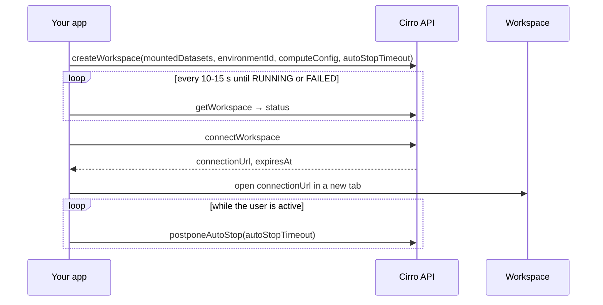

# Workspaces

A workspace is a container the user runs in their own project: JupyterLab, RStudio, VS Code, or any web app packaged as an image, with datasets mounted. For a front-end-only app it's the way to get interactive server-side compute (a Python kernel holding a large AnnData object, a Shiny app, a desktop tool) without running a back-end of your own. The workspace runs as the user, in their project, billed to it.

Use one when the work is interactive and too heavy for the browser. Use a [pipeline run](building-on-cirro.md#an-app-that-ships-its-own-pipeline) when it is batch work with a defined output, and the browser when the data fits in memory there.

## Lifecycle



`createWorkspace` starts the workspace by itself. Calling `startWorkspace` straight after fails with "Workspace is already changing state"; call it only to restart a stopped workspace you're reusing. `Workspace.status` moves through `PENDING`/`STARTING` to `RUNNING`, and through `STOPPING` to `COMPLETED`, which is what a stopped, restartable workspace reports (stopping can take several minutes). `FAILED` means it couldn't start; `getWorkspaceLogs` has the detail. `statusMessage` can carry internal identifiers such as an ECS task ARN, so log it rather than showing it to users.

## Booting takes minutes; say so

Starting a workspace usually takes a few minutes, and longer for larger images: the instance has to be provisioned and the image pulled. Users who aren't told assume the app is broken.

- Before starting, say how long it will take ("Starting a workspace takes a few minutes").
- While it boots, show the elapsed time and the status in plain words, and let the user keep working elsewhere in the app. Don't block the whole UI.
- Reuse before creating. List the project's workspaces (`getWorkspaces`), and offer to start a stopped (`COMPLETED`) one the app created earlier for the same purpose instead of making a new one. Find them by name prefix and provenance note, since workspaces don't carry tags (see [Tagging what the app creates](building-on-cirro.md#tag-everything-the-app-creates)).
- When it's ready, tell the user even if they've moved to another part of the app.

## The per-user limit

A project can limit how many workspaces one user may have in it; the project admin sets the number. Stopped workspaces count toward it. At the limit, `createWorkspace` is refused with a message saying so (for example "5 out of 5"). So:

- Reuse first, as above. An app should rarely need more than one workspace per purpose.
- At the limit, don't just show the error. List the user's workspaces in the project, with their names, status and last start, and offer to reuse one or delete one the user picks. Deleting needs the user's explicit confirmation, because files inside a workspace that weren't saved to the project are lost with it.

## Handing the user into the workspace

Open the workspace in a new tab. It can't be embedded in your app: the workspace server sends `frame-ancestors 'self' https://<cirro portal>` and `X-Frame-Options: SAMEORIGIN`, so an iframe on any other origin stays blank, and the page can't detect the block. See [known limitations](known-limitations.md#workspaces-open-in-a-new-tab).

```ts
async function openWorkspace(projectId: string, workspaceId: string) {
  const tab = window.open("", "_blank");   // during the click, or popup blockers win
  const { connectionUrl } = await dataService.workspaces.connectWorkspace({ projectId, workspaceId });
  if (tab) tab.location.href = connectionUrl;
}
```

- Call `connectWorkspace` on every click. `connectionUrl` carries a single-use `cirro-authenticate` code and expires about 5 minutes after it's issued (`expiresAt`), so never cache or reuse one.
- Open the tab synchronously in the click handler, then set its location once `connectWorkspace` returns. Otherwise browsers block the late `window.open`.
- Keep the workspace's state in your own UI while the user works in the other tab: status, auto-stop time, and buttons to extend, stop, and open again.

## Auto-stop

A running workspace costs money until it stops. `autoStopTimeout` (hours) stops it automatically.

- Always set `autoStopTimeout` on `createWorkspace`. A short value (1–2 hours) is right for app-launched workspaces.
- While the user is actively using the workspace, call `postponeAutoStop` periodically (for example every 15 minutes of activity) rather than setting a long timeout up front. Stop postponing when the tab is hidden or idle.
- Show `autoStopTime` in the UI ("Stops automatically at 3:40 pm"), with a button to extend it and one to stop now (`stopWorkspace`).
- When the user leaves the app, the workspace keeps running until auto-stop. Say so, rather than stopping it silently: they may have unsaved work in it.

## Getting results back

Files written inside a workspace stay in it until saved to the project. Decide up front how results come back to the app: a dataset the user saves from the workspace, a [sheet](sheets.md) the workspace writes to, or files the app reads from a known path. Tell the user which.

## Permissions

`CREATE_WORKSPACE`, `CONTROL_WORKSPACE` (start, stop, postpone), `OPEN_WORKSPACE` (connect), `DELETE_WORKSPACE`. Only project owners have `OPEN_WORKSPACE`; other users connect to a workspace they created or one shared with them. See the [capability map](building-on-cirro.md#capability-map).
